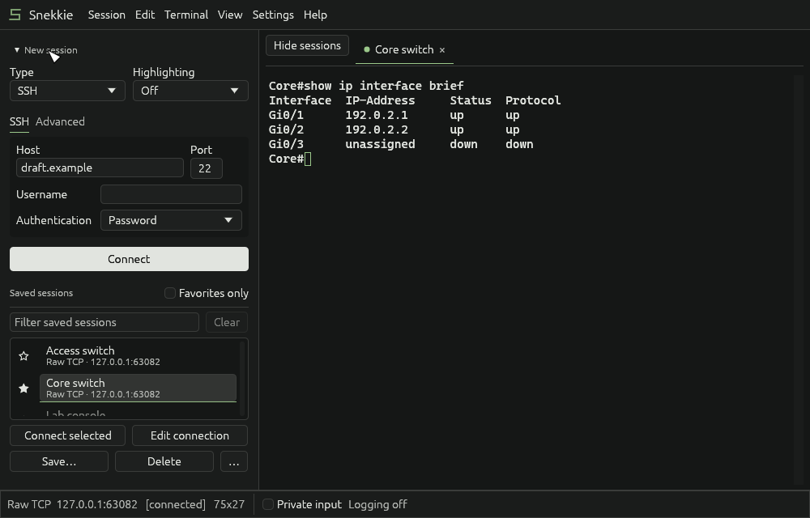
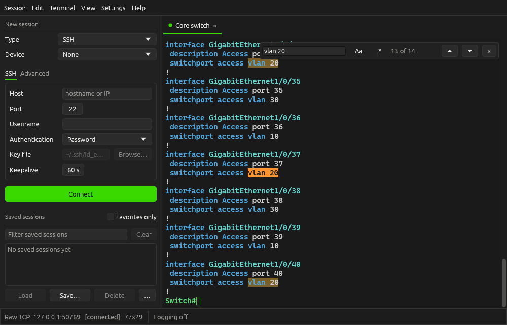
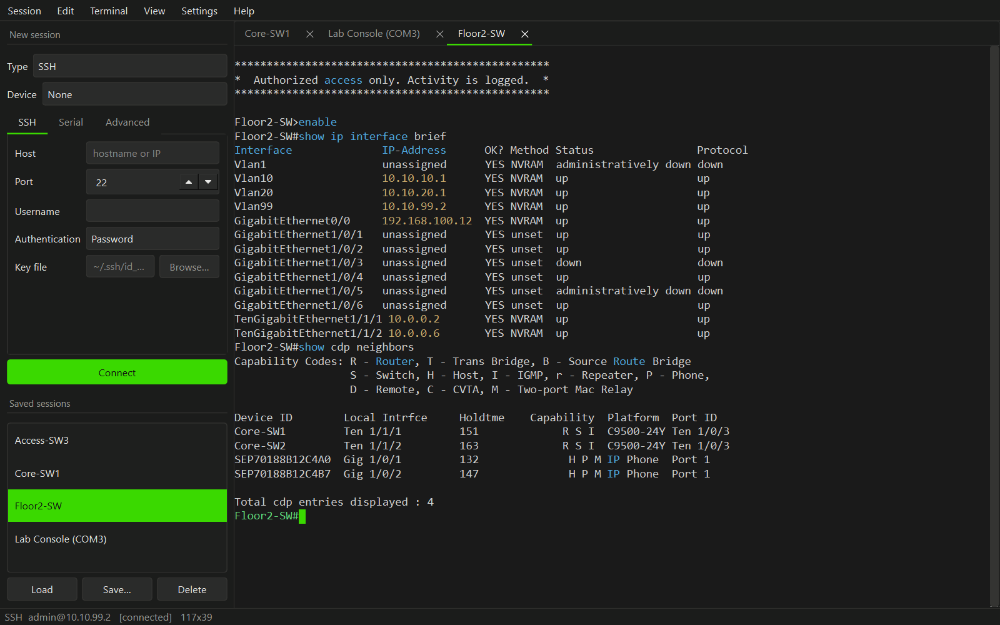
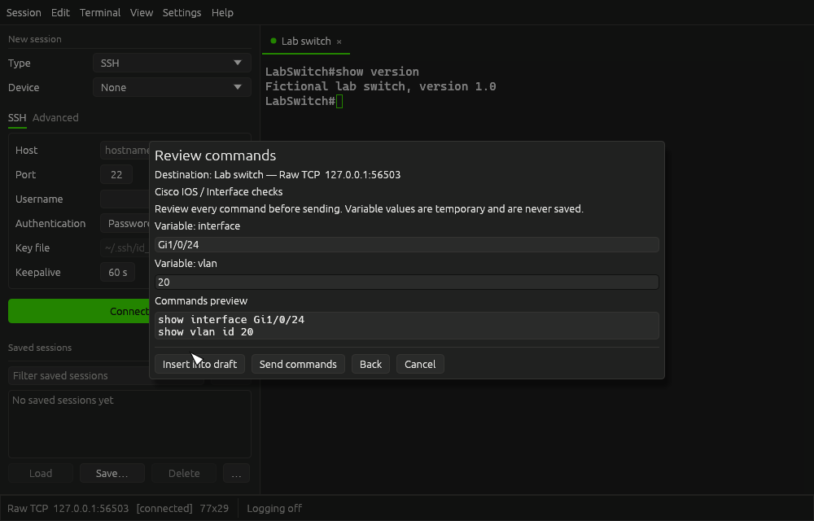
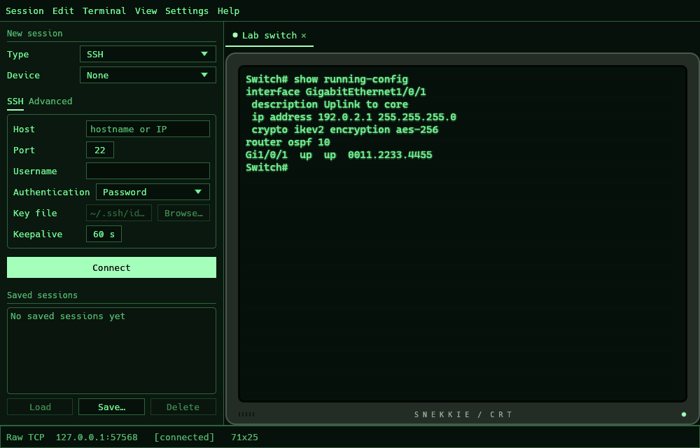
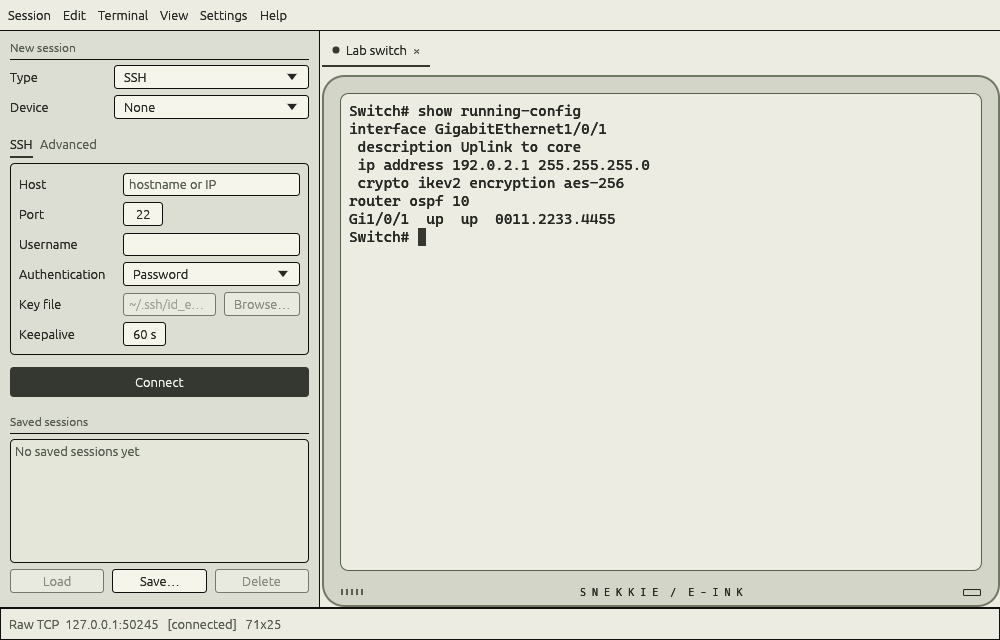
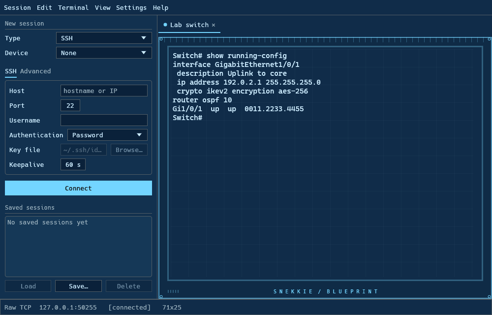

# Snekkie

Snekkie 2.8.0 is a tabbed SSH, Telnet, raw TCP and serial terminal for network engineers, built in Rust for Windows, Linux and macOS.

**[Download the Windows master installer](https://github.com/Dynamitecrown/Snekkie/releases/download/installer-v1.0.0/Snekkie-Setup.exe)**

Download this master installer once. It fetches and verifies the latest stable app from GitHub; future updates install through Snekkie's **Update** button.

[Offline Windows installers, portable Windows, Linux and macOS downloads](https://github.com/Dynamitecrown/Snekkie/releases/latest) · [2.8.0 release notes](docs/releases/2.8.0.md) · [All guides](docs/README.md)



## Contents

- [Features](#features)
- [Install and update](#install-and-update)
- [Keyboard shortcuts](#keyboard-shortcuts)
- [Settings and privacy](#settings-and-privacy)
- [Build and test](#build-and-test)
- [Documentation](#documentation)

## Features

### Connections

- **SSH, Telnet, raw TCP and serial** in one window, each in its own tab. SSH supports passwords, private key files and your SSH agent or default keys, with host-key verification against your `known_hosts` file.
- **Serial consoles** list available ports with their USB details. Baud rate, data bits, parity, stop bits and flow control are saved per profile. **Ctrl+Shift+B** sends a break on serial and Telnet sessions.
- **Keepalives, local echo and Backspace behavior** are configurable per profile under **Advanced**.
- **Tab status** uses distinct dots, rings and crosses for connected, connecting and disconnected, with the destination in the tooltip. **Reconnect** and **Duplicate** reopen a tab without retyping anything.

### Saved sessions

- **Save, filter and favorite.** Filter by name, host, serial device or protocol, and star favorites to show them alone. **Connect selected** or a double-click connects; **Edit connection** loads a profile without connecting.
- **Import from PuTTY** straight from the Windows registry or from an exported `.reg` file, on any platform. You review the sessions first; nothing connects and existing profiles are never replaced.
- **Import and export Snekkie profiles** as JSON to move them between computers. Passwords, private key contents and host-key trust are never exported.
- **Tab colors:** give a saved session a default tab color, or color any open tab temporarily from its right-click menu.
- **Compact layout:** collapse the new-session form, or hide the whole sidebar with **Ctrl+B**.

See the [session sidebar guide](docs/session-sidebar.md).

### Working in the terminal

- **Find** (**Ctrl+F**) searches the screen and scrollback, with match case and regular expressions. Every match is highlighted and the bar counts them.
- **Copy, save and append** terminal output from the right-click menu (**Ctrl+right-click**), including all retained scrollback. Saving offers `.txt`, `.cisco`, `.md`, `.cfg`, `.conf` and `.log`.
- **Paste safely.** Multiline pastes open a review first and are sent line by line with a short delay, which you can stop at any time. Right-click pastes as in PuTTY, or can open the menu instead.
- **Automatic paging** (off by default) answers `--More--` for `show` commands on Cisco IOS and ASA.



### Device syntax highlighting

Pick a platform per profile: **Cisco IOS / IOS XE**, **NX-OS**, **ASA**, **Juniper Junos**, **Aruba AOS-CX**, **Arista EOS**, **Fortinet FortiOS** or **Palo Alto PAN-OS**. One slider from 1 (Essential) to 5 (Full) sets how much is colored, from validated IPv4/IPv6 addresses and security settings up to numbers and table headings. Highlighting only changes the display: copied text, logs and the commands you send are untouched. See [Syntax highlighting](docs/syntax-highlighting.md).



### Command snippets

Save command templates with placeholders such as `{{interface}}`, fill them in when you use them, and review the final commands and the destination tab before anything is sent. Inserting or editing a snippet sends nothing; only **Send** does. Snippets can be shared as JSON. See [Command snippets](docs/command-snippets.md).



### Session logging

Turn on logging per profile to record both directions as readable text with timestamps, or as raw output. Logs rotate by size or day. Recognized password prompts are redacted, password logging is off unless you turn it on, and **Private input** keeps anything you type out of the log. The status bar shows whether the current tab is logging and opens its folder. See [Session logging](docs/session-logging.md).

### Themes and animations

- **21 built-in palettes**, including Solarized, Frost Light, Copper Night, Forest Night and Paper Light. Edit any of them and **Save as…** to keep your own.
- **Four complete app appearances:** CRT Super, Amber Super, E-Ink Super and Blueprint Super restyle the whole interface, with optional monochrome output, glow and scanlines.
- **Animations** for the cursor, typing and new output, from subtle fades to sparks and lasers. They are **off by default**, and **Reduce motion** picks a calm set in one click. Animations never change what is sent, copied or logged.

| CRT Super | E-Ink Super | Blueprint Super |
| --- | --- | --- |
|  |  |  |

See the [Preferences guide](docs/preferences.md) and the [2.5.0 feature guide](docs/new-features.md) for every theme and animation style.

### AI agent access

Optionally let an AI agent on your computer work in the sessions you have open, over the Model Context Protocol. Claude Code, Claude Desktop, OpenAI Codex and self-hosted agents can list your tabs, read their output, run a command and answer prompts such as `--More--`.

- **Off by default.** Turn it on under **Preferences → Network**, which also shows the exact command to add to your agent.
- **You stay in control.** Agents can't open, close or reconnect sessions and never see your passwords. Snekkie listens only on 127.0.0.1 with a fresh token, so other computers and other users can't connect.
- **You can see what they do.** The tab and terminal glow cyan while an agent reads and amber while it types, and the status bar names the agent. Everything it types appears in the tab and in the session log, as if you had typed it.
- **Notification-area icon (Windows).** Show or quit Snekkie, start or stop the agent server, or close the agent's bridge, even after Snekkie itself is closed.

See [AI agent access](docs/ai-agents.md).

## Install and update

**Windows:** Run `Snekkie-Setup.exe`. It downloads the latest version and installs for the current user without administrator rights. Saved sessions and settings survive upgrades.

For updates, click **Update to x.y.z → Update now**, or use **Help → Check for updates…**. Snekkie checks the installer's published SHA-256 before running it. You can also rerun the same master installer.

Full `Snekkie-Setup-<version>.exe` downloads support offline setup. Portable copies run without installation and link to new releases instead of updating themselves. For unattended installs, `/S` runs silently; add `/OFFLINE` or `/NOUPDATES` to set the network policy (see the [master installer guide](docs/master-installer.md)).

Windows downloads are currently unsigned, so SmartScreen may warn. See the [installer guide](docs/master-installer.md) and [signing policy](docs/code-signing.md).

**Linux and macOS:** Starting with 2.7.0, one install script picks the `.deb`, `.rpm`, Flatpak, AppImage or universal macOS app that suits your computer, verifies it against the release checksums and installs it. Run it again to update:

```bash
curl -fsSLO https://github.com/Dynamitecrown/Snekkie/releases/download/unix-installer-v1.0.0/snekkie-install.sh
sh snekkie-install.sh
```

Each package can also be downloaded and installed by itself. See [Installing on Linux and macOS](docs/linux-and-macos.md) for per-distribution commands, macOS first launch and serial permissions.

Linux serial access may require membership in `dialout`. On Windows, install your USB console cable's driver if its COM port is missing.

## Keyboard shortcuts

On macOS, use **Cmd** in place of **Ctrl** for these.

| Action | Shortcut |
| --- | --- |
| New session | Ctrl+Shift+N |
| Duplicate tab / Reconnect | Ctrl+Shift+D / Ctrl+Shift+R |
| Close tab | Ctrl+W |
| Next / previous tab | Ctrl+Tab / Ctrl+Shift+Tab, or Ctrl+PageDown / Ctrl+PageUp |
| Copy / Paste | Ctrl+Shift+C / Ctrl+Shift+V |
| Find in output | Ctrl+F |
| Command snippets | Ctrl+Shift+S |
| Clear screen | Ctrl+Shift+L |
| Send break (serial, Telnet) | Ctrl+Shift+B |
| Show or hide the sidebar | Ctrl+B |
| Preferences | Ctrl+, |
| Quit | Ctrl+Q |

**Help → Keyboard shortcuts** lists them in the app.

## Settings and privacy

- **Where settings live:** `%APPDATA%\snekkie` on Windows, `~/.config/snekkie` on Linux and `~/Library/Application Support/snekkie` on macOS. Profiles, preferences, snippets and themes are plain JSON files there.
- **No stored passwords.** Snekkie asks for passwords and key passphrases when you connect and never writes them to disk.
- **Offline mode** (optional, also offered by the Windows installer) turns off update checks and asks before each connection to an address outside private and local ranges, and before looking up a hostname. Approval is for one attempt only. Serial and private-network connections work as usual.
- **Update checks** can be turned off on their own, without offline mode.

See [Network privacy](docs/new-features.md#network-privacy-and-installation).

## Build and test

Install [Rust stable](https://rustup.rs), then:

```bash
cargo run --release
cargo test --locked
```

On Windows, `build-windows.bat` also builds the full installer when [NSIS 3](https://nsis.sourceforge.io) is installed. Linux packages and the macOS disk image are built by the scripts described in [packaging/README.md](packaging/README.md).

## Documentation

| Guide | What it covers |
| --- | --- |
| [Preferences](docs/preferences.md) | Every settings section, previews, themes and save/cancel behavior |
| [Session sidebar](docs/session-sidebar.md) | Saved sessions, connection options and tab status |
| [Syntax highlighting](docs/syntax-highlighting.md) | Platforms and intensity levels |
| [Command snippets](docs/command-snippets.md) | Templates, variables, review and sharing |
| [Paste behavior](docs/paste-behavior.md) | Multiline review, pacing and right-click options |
| [Session logging](docs/session-logging.md) | Formats, timestamps, password controls and rotation |
| [AI agent access](docs/ai-agents.md) | Connecting a local MCP agent, what it can do and safety |
| [Master installer](docs/master-installer.md) | Windows installation, updates and silent setup |
| [Linux and macOS](docs/linux-and-macos.md) | Install script, packages, macOS first launch and serial permissions |
| [All guides and release history](docs/README.md) | Everything else, including past release notes |

## License

[GPL-3.0-or-later](LICENSE).
