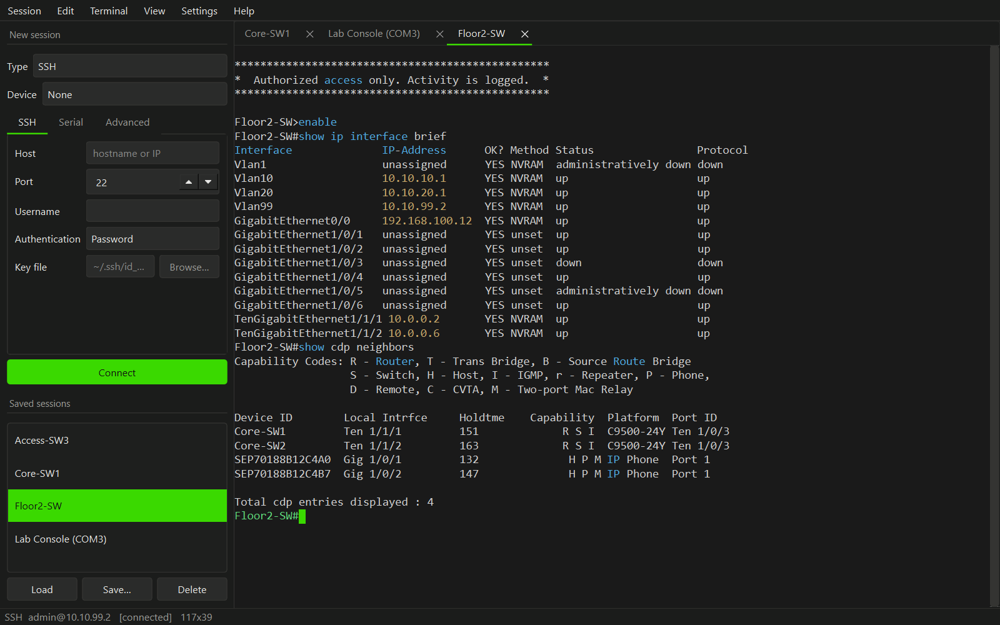

# Snekkie

A tabbed SSH, Telnet, raw TCP and serial terminal for network engineers, built in Rust for Windows and Linux.

**[Download the Windows master installer](https://github.com/Dynamitecrown/Snekkie/releases/download/installer-v1.0.0/Snekkie-Setup.exe)**

Download this master installer once. It fetches and verifies the latest stable app from GitHub; future updates install through Snekkie's **Update** button.

[Offline Windows installers, portable Windows and Linux downloads](https://github.com/Dynamitecrown/Snekkie/releases/latest) · [2.6.0 release notes](docs/releases/2.6.0.md)

## What it does

- Saved sessions, tabs, favorites and PuTTY import.
- Scrollback search, device syntax highlighting and paste controls.
- Command snippets and local session logging.
- Custom themes and optional offline mode.



## Install and update

**Windows:** Run `Snekkie-Setup.exe`. It downloads the latest version and installs for the current user without administrator rights. Saved sessions and settings survive upgrades.

For updates, click **Update to x.y.z → Update now**, or use **Help → Check for updates…**. You can also rerun the same master installer.

Full `Snekkie-Setup-<version>.exe` downloads support offline setup. Portable copies run without installation and link to new releases instead of updating themselves.

Windows downloads are currently unsigned, so SmartScreen may warn. See the [installer guide](docs/master-installer.md) and [signing policy](docs/code-signing.md).

**Linux (x86_64):** Download `snekkie-linux-x86_64.tar.gz`, then run:

```bash
tar -xzf snekkie-linux-x86_64.tar.gz
./snekkie
```

Linux serial access may require membership in `dialout`. On Windows, install your USB console cable's driver if its COM port is missing.

## Build and test

Install [Rust stable](https://rustup.rs) and, on Linux, `pkg-config` and libudev development headers. Then:

```bash
cargo run --release
cargo test --locked
```

On Windows, `build-windows.bat` also builds the full installer when [NSIS 3](https://nsis.sourceforge.io) is installed.

## Documentation

[Guides and feature documentation](docs/README.md)

## License

[GPL-3.0-or-later](LICENSE).
