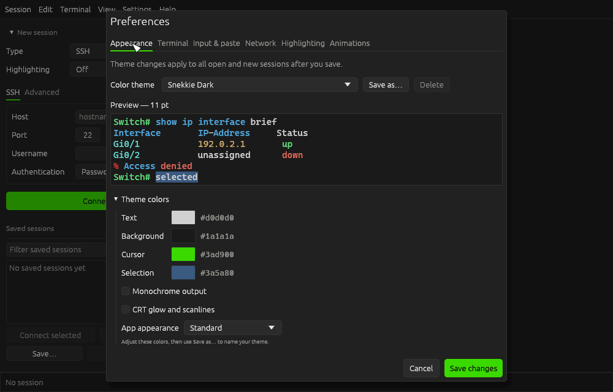
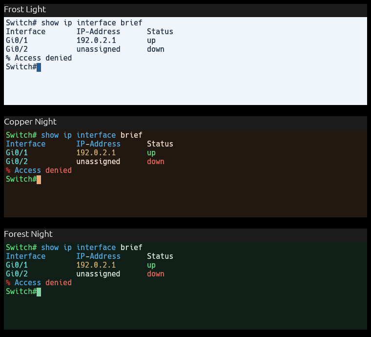
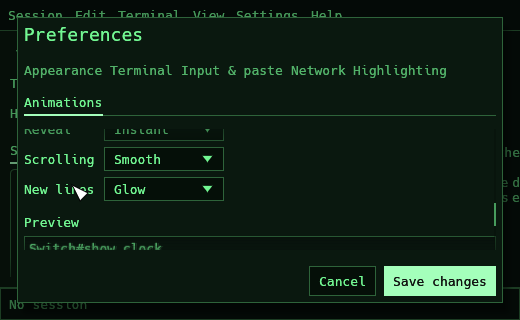
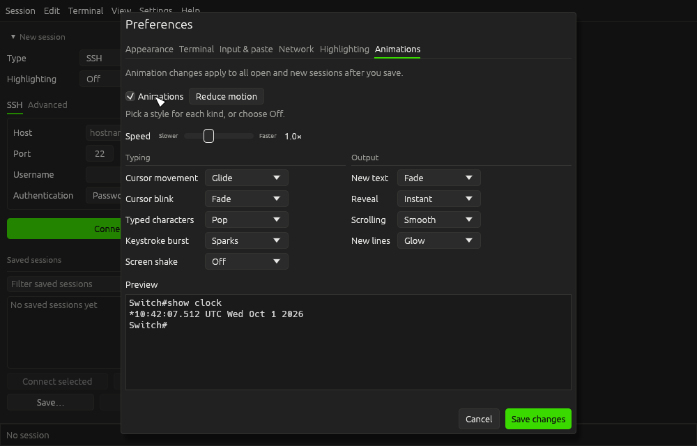

# Preferences

Open **Settings → Preferences…**, or press **Ctrl+,** (**Cmd+,** on macOS). Settings are grouped into six sections. The section tabs wrap in a narrow window, and each section keeps its own scroll position.

| Section | Controls | When changes take effect |
| --- | --- | --- |
| Appearance | Preset themes, custom colors, monochrome output and app appearance | All open and new sessions after saving |
| Terminal | Default font family, font size and scrollback | When starting a **New session**; open sessions and saved profiles retain their own settings |
| Input & paste | Right-click behavior, multiline paste review, paste delay and automatic paging | Future input and paste actions in open and new sessions after saving |
| Network | Offline mode and startup update checks | Network policy applies on saving; the startup-check choice is used on the next launch |
| Highlighting | Global highlighting intensity and a device sample | All open and new sessions after saving |
| Animations | Master switch, speed, typing styles and output styles | All open and new sessions after saving |

## Save or discard changes

**Save changes** applies the draft from every section and closes Preferences. **Cancel** or **Escape** discards edits from every section. Switching sections does not save. The buttons remain fixed at the bottom of the dialog, with **Save changes** on the right, while the section content scrolls.

Saving a theme through **Save as…** adds a named theme to the Preferences draft. Replacing or deleting a saved theme asks for confirmation. These changes are written only when you choose **Save changes**; Cancel discards them too. Editing a preset's colors creates a Custom draft rather than overwriting the preset.

## Appearance and terminal previews

Appearance and Terminal show a larger sample containing a prompt, interface table, status, error, cursor and selection. Both previews use the current draft's terminal font family and point size through the same font loader and renderer as real sessions. Changing a font or theme updates the sample without changing an open session.

The font-size control uses points, matching saved connection profiles. Very large fonts show fewer lines in the preview. Fonts that are unavailable use the normal terminal fallback. A named saved profile keeps its own font settings; use the session sidebar's **Edit connection → Advanced** to change that profile.

On the Highlighting page, **Preview device** changes only the sample. Choose a real session's device rules using the sidebar's **Highlighting** menu.

## New palettes and contrast review

There are 21 built-in themes. The three new palettes keep the standard app controls and change the terminal colors:

| Theme | Appearance |
| --- | --- |
| Frost Light | Cool white paper, dark blue text and a blue selection; monochrome output keeps colored device text readable |
| Copper Night | Warm charcoal, cream text and a copper cursor; preserves device and syntax colors |
| Forest Night | Deep green, pale text and a mint cursor; preserves device and syntax colors |

The review also strengthened the two Solarized foregrounds:

| Before | After |
| --- | --- |
| Solarized Dark foreground `#839496`: selected base text 4.11:1 | `#93a1a1`: selected base text 4.86:1 |
| Solarized Light foreground `#657b83`: base text 4.13:1, selected base text 3.64:1 | `#52676f`: base text 5.52:1, selected base text 4.86:1 |

Every built-in palette is regression-checked for at least 4.5:1 base-text contrast against both the terminal background and selection, and 3:1 cursor contrast against the background. These checks cover the four theme colors; device-specified ANSI colors, syntax colors and custom colors are separate. Existing named themes keep their saved colors, including names matching a new preset.

## Network privacy

Enabling **Offline mode** disables update checks and downloads, asks before DNS lookups or connections outside private/local IP ranges, and closes existing network sessions when saved. Serial sessions remain connected. Preferences displays a warning with the current number of open network sessions before applying this change. Cancel leaves those sessions and the saved policy intact.

While an update is busy, the offline-mode control is disabled and explains why. Turning Offline mode off does not automatically re-enable startup update checks; enable that option separately if desired.

## Compact animation controls

The Typing and Output groups appear side by side in a wide dialog and stack vertically in a compact one. Scroll the section to reach every style and its preview. Disabling animations keeps the individual style choices. Animations remain off by default.

The new **Focus** text effect starts at 96% size and fades into place over 200 ms. **Bookends** marks fresh output with short brackets for 200 ms. **Outline** frames it with a thin border for 250 ms. The two line effects leave the text stationary. These times are at normal speed; the speed slider applies to them too.

**Cursor blink → Steady** keeps the cursor visible without blinking or a halo, and schedules no idle blink frames. **Reduce motion** selects a steady cursor, immediate typing and scrolling, instant output reveal, no particles or shake, and a short opacity-only output fade. It also enables the master switch so the preset can be previewed. Like other edits, it takes effect in sessions only after **Save changes**, and Cancel discards it.

## Verification

Run `cargo run --locked --example preferences_qa` to render every section at 1000 × 640 and 520 × 320 in dark, light, CRT, E-Ink and all three new palettes. It uses temporary settings and never writes the user's preferences. Images are written to `target/preferences-qa/`.

Run `cargo run --locked --example themes_motion_qa` for terminal samples of all 21 palettes and 19-frame timelines of each new output effect in four palettes. Images are written to `target/themes-motion-qa/`. The timelines assert that animations preserve the emulator text. Unit regressions exercise every animation choice, check bounded cursor opacity, and verify transient effects settle even at the slowest speed.

For a manual check, change a theme and font, visit another section, and compare **Cancel** with **Save changes**. In a small window, check that all section tabs, animation styles and footer buttons remain reachable. With a network session open, enable Offline mode, read the warning, then Cancel to keep the session connected.
