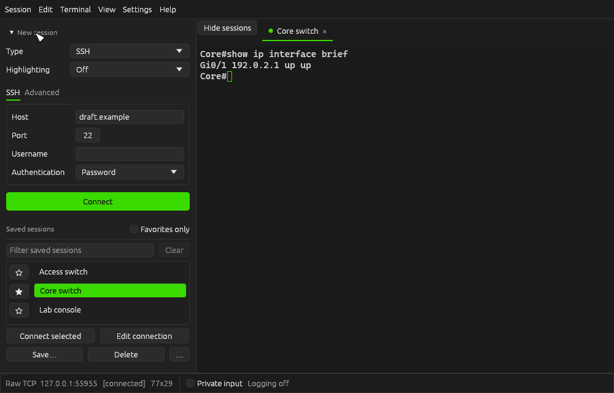
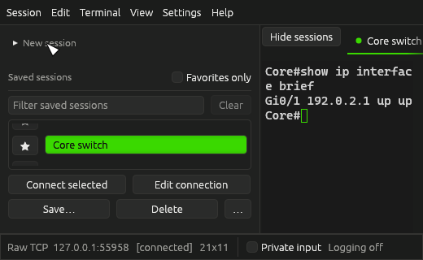

# Session sidebar

Use **Show sessions** or **Hide sessions**, beside the session tabs, to give the terminal more room. The same action is available through **Ctrl+B** (**Cmd+B** on macOS). Sidebar visibility is saved between launches. Hiding the sidebar keeps the unfinished connection form and saved-session filters intact.

## Connect or edit a saved session

1. Select a row under **Saved sessions**.
2. Choose **Connect selected** to open that profile with its saved destination and options. Double-clicking the row does the same thing. Neither action replaces the unfinished form.
3. Choose **Edit connection** instead to load the profile into the form without connecting. This opens **New session** if it was collapsed. Make changes there, then choose **Connect** to use the form, or **Save…** to save it.

The form's **Connect** button always uses the form. **Connect selected** always uses the selected saved profile, even when the form contains a different destination. Selecting a row alone never connects or changes the form.

Filtering or **Favorites only** can hide the selected profile. When that happens, **Connect selected**, **Edit connection**, and **Delete** are disabled until a visible profile is selected or the filter is cleared. Saving still saves the form.

## Make room for saved sessions

Click the arrow beside **New session** to collapse the connection form independently of the saved-session list. This is useful in short windows. **Edit connection** and **Session → New session** reopen the form; the latter resets it for a new connection.

Saved-session action buttons stack when the sidebar or theme font is too narrow to fit their labels side by side. The sidebar remains scrollable when its content exceeds the window height.

## Connection options

- **Highlighting** selects the device syntax rules. **Off** preserves device output colors without adding syntax highlighting. This changes presentation, not the connection target.
- SSH's **Key file** field appears only when **Private key file** authentication is selected. Switching authentication does not erase the stored key path.
- Network **Keepalive** is under **Advanced**. It retains its existing value and defaults; serial sessions do not show this option.

## Tab connection status

A filled dot indicates **Connected**, an outlined ring indicates **Connecting**, and a cross indicates **Disconnected**. These shapes remain distinct when colors are similar. Hover over a tab to see its name, destination, and connection state, including inactive tabs. Status indicators also have accessible text names.

## Visual checks

Run `cargo run --locked --example sidebar_qa` to render the current interface at 1000 × 640 and 520 × 320 in standard, light, CRT, and E-Ink themes. It uses temporary stores and a fictional local TCP device; it does not open saved user sessions. Images are written to `target/sidebar-qa/`.

For a manual check, select a saved session while a different host is in the form and verify both connection actions use their stated destination. At a small window size, collapse **New session**, use the saved-session actions, and hide/show the sidebar. Check tab status tooltips with more than one session open.
