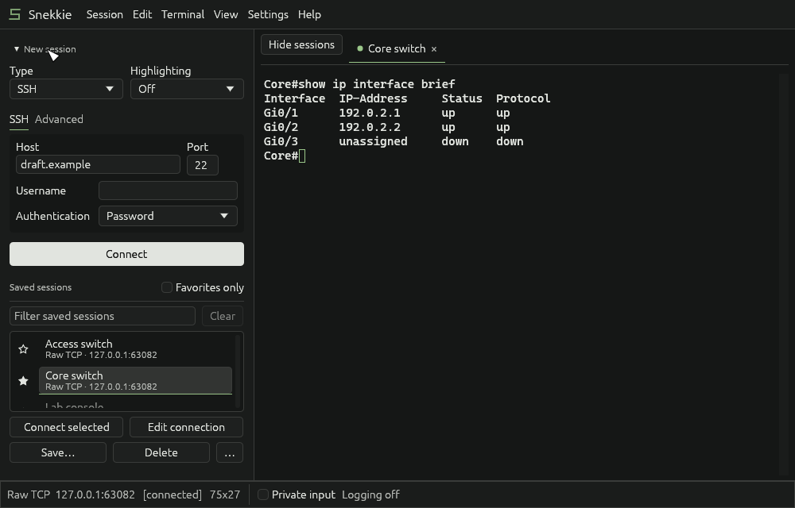
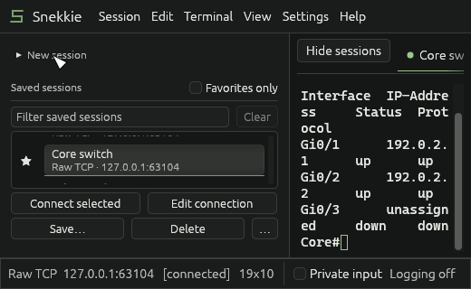

# Session sidebar

Use **Show sessions** or **Hide sessions**, beside the session tabs, to give the terminal more room. The same action is available through **Ctrl+B** (**Cmd+B** on macOS). Sidebar visibility is saved between launches. Hiding the sidebar keeps the unfinished connection form and saved-session filters intact.

The empty workspace offers **New connection**, which opens and resets the connection form. The menu bar carries Snekkie's name and a small snake mark. Network forms place **Host** and **Port** together, leaving more room for saved sessions.

## Connect or edit a saved session

1. Select a row under **Saved sessions**.
2. Choose **Connect selected** to open that profile with its saved destination and options. Double-clicking the row does the same thing. Neither action replaces the unfinished form.
3. Choose **Edit connection** instead to load the profile into the form without connecting. This opens **New session** if it was collapsed. Make changes there, then choose **Connect** to use the form, or **Save…** to save it.

The form's **Connect** button always uses the form. **Connect selected** always uses the selected saved profile, even when the form contains a different destination. Selecting a row alone never connects or changes the form.

Each saved row shows its alias above its protocol and destination. Serial rows include the device and baud rate. Long lines shorten independently; hover for the full destination. Selection uses a neutral fill and a thin accent line, while the star remains a separate favorite action.

Filtering or **Favorites only** can hide the selected profile. When that happens, **Connect selected**, **Edit connection**, and **Delete** are disabled until a visible profile is selected or the filter is cleared. Saving still saves the form.

## Make room for saved sessions

Click the arrow beside **New session** to collapse the connection form independently of the saved-session list. This is useful in short windows. **Edit connection** and **Session → New session** reopen the form; the latter resets it for a new connection.

## Folders

Choose **…** > **New folder…** to add a folder. Folders can hold other folders, up to six levels deep, and a session can be in one folder.

| To do this | Do this |
| --- | --- |
| Put a session in a folder | Drag it onto the folder, or right-click it and choose **Move to folder** |
| Take a session out | Right-click it and choose **Move to folder** > **No folder** |
| Open or close a folder | Click it. Snekkie remembers which are closed |
| Save a new session into a folder | Right-click the folder and choose **New session here** |
| Add, rename, move or delete a folder | Right-click it |

Deleting a folder never deletes a session. What was inside moves up one level, and Snekkie tells you how many sessions that affects first.

While you filter or show favorites only, closed folders with a match open, and folders without one hide. The filter also matches folder names. Exports include each session's folder, and imports recreate it.

Saved-session action buttons stack when the sidebar or theme font is too narrow to fit their labels side by side. Short windows use tighter sidebar controls and spacing. The sidebar remains scrollable when its content exceeds the window height.

## Connection options

- **Highlighting** selects the device syntax rules. **Off** preserves device output colors without adding syntax highlighting. This changes presentation, not the connection target.
- SSH's **Key file** field appears only when **Private key file** authentication is selected. Switching authentication does not erase the stored key path.
- Network **Keepalive** is under **Advanced**. It retains its existing value and defaults; serial sessions do not show this option.
- Serial sessions have **Enter sends** under **Advanced**: **CR** (the default), **LF** or **CR+LF**. It applies to Enter, pastes and snippets. **Treat received LF as CR+LF** (off by default) fixes output that steps down without returning to the left edge. Both are saved with the profile and included in exports; PuTTY's "Implicit CR in every LF" setting imports as the second.

## Check port

Right-click a saved SSH, Telnet or raw TCP session and choose **Check port**. Snekkie tries one TCP connection to its host and port, with a 3 second timeout, and shows the result in the status bar: open (with the time in milliseconds), refused, or timed out. It runs only when you ask and never pings. In offline mode the usual approval applies to hostnames and public addresses.

## Tab connection status

A filled dot indicates **Connected**, an outlined ring indicates **Connecting**, and a cross indicates **Disconnected**. These shapes remain distinct when colors are similar. Hover over a tab to see its name, destination, and connection state, including inactive tabs.

When the cursor sits at a device prompt such as `SW1#`, `SW1(config-if)#` or `admin@fw>`, serial and unsaved tabs take the hostname as their name; saved sessions keep theirs and show **Device:** with the hostname in the tooltip. The status bar shows the CLI mode for the current tab: **user** (`>`), **privileged** (`#`) or **config** (a prompt containing `(config`), with config in a colored badge. Shell prompts such as `user@host:~$` give the hostname but no mode. Status indicators also have accessible text names.

### Reconnect when back

When a device reboots, right-click its disconnected SSH, Telnet or raw TCP tab and choose **Reconnect when back**. Snekkie tries a TCP connection to the port every few seconds, slowing to every 30 seconds, and reconnects as soon as it is accepted. It gives up after 30 minutes. The tab tooltip and status bar show **Waiting for host…**; use **Stop waiting** there or **Stop waiting for host** in the tab menu to cancel. You still answer any password prompt. In offline mode this works only for private or local IP addresses, because every check of another address would need approval.

### Reopen tabs from last time

Turn on **Preferences → Terminal → Reopen tabs from last time** to get your saved-session tabs, explorers and split view back on the next start. They open disconnected; choose **Reconnect** on each one you need. See [Preferences](preferences.md#startup).

## Visual checks

Run `cargo run --locked --example sidebar_qa` to render empty, connected, collapsed, hidden-sidebar and disconnected states at 1000 × 640, 720 × 540 and 520 × 320. It covers Snekkie Dark, Paper Light, Frost Light, Copper Night, Forest Night, CRT and E-Ink. It uses temporary stores and a fictional local TCP device; it does not open saved user sessions. Images are written to `target/sidebar-qa/`.

For a manual check, select a saved session while a different host is in the form and verify both connection actions use their stated destination. At a small window size, collapse **New session**, use the saved-session actions, and hide/show the sidebar. Check tab status tooltips with more than one session open.
